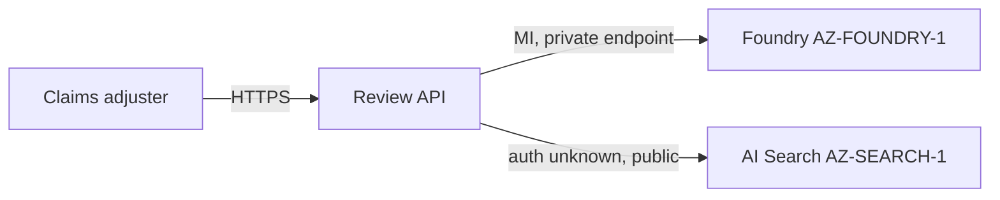

# Design assurance discovery report: Contoso claims reviewer (synthetic)

> Synthetic example. Internal discovery output for independent architectural
> review. Every statement cites evidence IDs from `evidence.json`.

## 1. Application overview

Reviews insurance claim summaries for numeric consistency before adjuster
sign-off (EV-README-PURPOSE). Estimated volume: a few hundred reviews per week,
from interview, not measured (EV-INTERVIEW-VOLUME).

## 2. Discovery scope and limitations

| Item | Value |
| --- | --- |
| Profiles | azure-agent, example-platform, example-document-review |
| Discovery modes | repository, azure_configuration (test), interview |
| Environments inspected | test |
| Evidence sources unavailable | role assignments (forbidden), telemetry (not authorised), production |

## 3. Current implementation and maturity

Working pipeline in test. Coverage and maturity are reported separately in
`discovery-coverage.json`; most criteria remain **U** because only the
repository and one environment were inspected.

## 4. Known challenges and outstanding work

No issue tracker or TODO markers documenting outstanding work were found.

## 5. Architecture

### 5.1 Infrastructure architecture

Foundry account (AZ-FOUNDRY-1, private, local auth disabled) and AI Search
(AZ-SEARCH-1, public) in one resource group (EV-AZ-FOUNDRY-1, EV-AZ-SEARCH-1).

### 5.2 Logical application architecture

### 5.3 Agent architecture and execution

Deterministic three-stage pipeline FLOW-REVIEW: enumerate claims (model),
compare values (Decimal), summarise (model). No human approval step found
(EV-ORCH-LOOP, EV-ORCH-ENUM, EV-ORCH-NUMERIC).

### 5.4 Knowledge and data architecture

Search index used for policy lookups; schema, chunking and embeddings unknown.

### 5.5 Network and identity architecture

User-assigned managed identity; keyless (EV-BICEP-MI, EV-APP-CRED). Search
reachable publicly (EV-AZ-SEARCH-1).

## 6. Findings by discovery domain

### Domain 01: Business context and workload characteristics

Purpose documented (BC-01, maturity 3). Volume estimated only.

### Domain 02: Microsoft technology stack and current capability alignment

Foundry SDK pinned (MT-02, 3); framework choice documented in ADR (MT-04, 3).

### Domain 03: Azure infrastructure and Well-Architected principles

Network isolation conflicting: baseline vs public search (WA-02, 2).

### Domain 04: Customer platform standards

Keyless auth meets baseline (PLT-02, 4); private networking partial (PLT-01, 2).

### Domain 05: Software engineering and application architecture

Typed configuration (SE-03, 3); exact pins without update tooling (SE-04, 3).

### Domain 06: Agent architecture, orchestration and model strategy

Code-defined control flow (AE-01, AE-04, 3).

### Domain 07: Data ingestion, knowledge architecture and retrieval

No ingestion pipeline: KR-02 not applicable. Index design unknown.

### Domain 08: Functional assurance, correctness and human oversight

Enumeration unchecked (FA-03, WRK-01, 1); numeric comparison deterministic (WRK-02, 3).

### Domain 09: Evaluations, guardrails and behavioural assurance

Evaluation framework confirmed absent in this repository (EG-01, 0; EV-NO-EVALS).

### Domain 10: Security, identity and data governance

Least-privilege workload identity (SG-02, 4). RBAC not collected.

### Domain 11: Observability, reliability, scalability and economics

Per-stage GenAI spans, content recording off (OS-02, 3).

### Domain 12: Lifecycle, traceability and operational ownership

Prompt versioned in Git; no evaluation gate (LT-03, 2).

## 7. Existing strengths

- OBS-001 keyless authentication end to end.
- OBS-005 deterministic numeric comparison.

## 8. Potential gaps and implications

- OBS-002 claim enumeration completeness unverified (high).
- OBS-003 no evaluation framework (high).
- OBS-004 public AI Search endpoint (medium).

## 9. Architectural decisions and rationale

DD-001 documented (ADR 0002). DD-002 inferred; rationale not documented.

## 10. Workload and runtime characteristics

WL-VOLUME estimate only; WL-CLAIMS unknown.

## 11. Unknowns and conflicting evidence

WRK-01: briefing claims exhaustive review; implementation does not verify
completeness. Most criteria are U; see `assessment.csv`.

## 12. Questions for the development team

See `open-questions.md`. P1: Q-001 (enumeration recall), Q-002 (evaluations).
